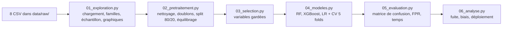

# Architecture du projet IDS multi-classes

Ce document explique le projet simplement, étape par étape. Il est mis à jour
après chaque étape avec les résultats réels, une explication du code et cinq
questions possibles du jury.

## État d'avancement

| Étape | Script | État |
|---|---|---|
| 1. Exploration | `01_exploration.py` | terminée |
| 2. Prétraitement et déséquilibre | `02_pretraitement.py` | terminée |
| 3. Sélection de variables | `03_selection.py` | terminée |
| 4. Modèles et validation croisée | `04_modeles.py` | terminée |
| 5. Évaluation sur le test | `05_evaluation.py` | terminée |
| 6. Analyse critique et déploiement | `06_analyse.py` | terminée |

Le projet est volontairement plat : `config.py` plus un script par étape.
Il n'y a pas de classes, ni de dossier `src/` avec dix modules.

---

## 1. Qu'est-ce qu'un IDS ?

Un IDS (*Intrusion Detection System*) observe une activité et signale ce qui
semble suspect. Il alerte, il ne bloque pas forcément le trafic.

- **NIDS** : analyse le trafic réseau, via un port miroir (SPAN) ou un TAP.
- **HIDS** : analyse les logs et les processus d'une machine.

Trois façons de détecter :

| Méthode | Idée | Force | Faiblesse |
|---|---|---|---|
| Signatures | règles connues (Snort, Suricata) | fiable, explicable | rate les attaques inconnues |
| Anomalies | apprentissage du comportement normal | peut surprendre | beaucoup de fausses alertes |
| Machine learning | apprentissage à partir de flux étiquetés | automatique | dépend des données |

Notre projet est un **NIDS supervisé multi-classes** : à partir d'un flux résumé
en statistiques, il prédit la famille d'attaque ou `BENIGN`.

## 2. Le dataset CIC-IDS2017

Publié par le Canadian Institute for Cybersecurity (Université du
Nouveau-Brunswick), capture du 3 au 7 juillet 2017. Page officielle :
<https://www.unb.ca/cic/datasets/ids-2017.html>.

Le lundi contient seulement du trafic normal ; les autres jours contiennent
des attaques scriptées : brute force FTP/SSH, DoS, Heartbleed, Web attacks,
infiltration, botnet, DDoS, PortScan. Chaque ligne d'un CSV est un flux extrait
par CICFlowMeter.

Colonnes utiles à connaître :

| Colonne | Signification |
|---|---|
| `Flow Duration` | durée du flux en microsecondes |
| `Total Fwd Packets`, `Total Length of Fwd Packets` | paquets et octets dans le sens initial |
| `Flow Bytes/s`, `Flow Packets/s` | débits (source de valeurs infinies) |
| `Flow IAT Mean`, `Fwd IAT Mean` | temps moyen entre deux paquets (*Inter Arrival Time*) |
| `Packet Length Mean` | taille moyenne des paquets |
| `SYN Flag Count`, `RST Flag Count`, `ACK Flag Count` | drapeaux TCP : connexion, fermeture brutale |
| `Source IP`, `Destination IP`, `Source Port`, `Destination Port`, `Timestamp` | identifiants ou horodatage, à retirer plus tard |

Les libellés bruts sont regroupés en familles pour être lisibles et assez
peuplées :

| Famille | Libellés regroupés |
|---|---|
| `BENIGN` | `BENIGN` |
| `DoS` | GoldenEye, Hulk, Slowloris, Slowhttptest |
| `DDoS` | `DDoS` |
| `PortScan` | `PortScan` |
| `BruteForce` | FTP-Patator, SSH-Patator |
| `WebAttack` | Brute Force, XSS, Sql Injection |
| `Bot`, `Infiltration`, `Heartbleed` | conservés tels quels pour l'instant |

**Échantillon** : 5 % par famille avec graine 42 ; les familles de 100 lignes
ou moins sont gardées entièrement, sinon `Heartbleed` (11 lignes) aurait
disparu. Le déséquilibre d'origine est donc conservé.

## 3. Vue d'ensemble du pipeline



## 4. Les fichiers du projet

| Fichier | Rôle |
|---|---|
| `config.py` | graine, chemins, mapping des familles, colonnes à retirer |
| `01_exploration.py` | lit les CSV, crée l'échantillon, produit les graphiques et tableaux |
| `02_pretraitement.py` ... `06_analyse.py` | une étape chacun, créés au fur et à mesure |
| `data/raw/MachineLearningCVE/` | CSV officiels (non versionnés) |
| `data/processed/` | échantillon et jeux d'entraînement/test |
| `reports/figures/`, `reports/tables/` | graphiques et tableaux CSV |
| `models/` | modèle final sauvegardé |

## 5. Choix techniques déjà faits

- **Échantillon stratifié** : le jeu complet fait 2,8 millions de lignes, trop
  lourd pour un PC ; 5 % suffisent pour comparer des modèles.
- **Libellés normalisés** : sans cela, 7 976 lignes partaient dans `AUTRE`.
- **Doublons pas encore supprimés** : on les a comptés à l'étape 1, on les
  retirera avant le split à l'étape 2 pour éviter la fuite de données.
- **Identifiants et timestamp** : la liste `RISKY_COLUMNS` est appliquée à
  l'étape 2. Dans la version des CSV fournie ici, ces colonnes ne sont déjà
  pas présentes (le fichier commence par `Destination Port`) : aucune
  suppression n'a donc été faite. Le `Destination Port` est gardé car c'est
  une information disponible en production (service visé), mais son
  importance sera surveillée aux étapes 3 et 6.
- **F1 macro et PR-AUC** (plus tard) plutôt que l'accuracy : 80 % des flux sont
  `BENIGN`, donc l'accuracy est trompeuse.

Les sections 6 (algorithmes) et 7 (métriques détaillées) seront complétées aux
étapes 4 et 5.

## 8. Comment exécuter

Depuis le dossier du projet :

```bash
pip install -r requirements.txt
python 01_exploration.py
python 02_pretraitement.py
python 03_selection.py
python 04_modeles.py
python 05_evaluation.py
python 06_analyse.py
```

Le script lit les 8 CSV, écrit `data/processed/sample_stratified_5pct.csv`, puis
les graphiques dans `reports/figures/` et les tableaux dans `reports/tables/`.
Pour lire les résultats : `distribution_classes.csv` montre le déséquilibre,
`valeurs_manquantes.csv` et `valeurs_infinies.csv` les cellules à corriger,
`doublons.csv` le risque de fuite, `correlations_fortes.csv` les variables
redondantes, et `correlations.png` la heatmap.

## 9. Pièges rencontrés

- **Libellés sales** : `DoS slowloris` en minuscules, et `Web Attack` suivi d'un
  caractère de remplacement `U+FFFD` au lieu d'un espace. Corrigé par une
  normalisation des caractères et un mapping insensible à la casse.
- **Doublons** : 5 549 lignes identiques (3,92 %), à traiter avant le split.
- **Valeurs infinies** : 162 cellules dans les débits, à remplacer par NaN puis
  imputer sur le train seulement.
- **Corrélations** : 48 paires à plus de 0,95, dont des doublons de colonnes
  calculées deux fois par CICFlowMeter.
- Aucun score de modèle n'a encore été calculé : on ne peut donc pas encore
  parler de score « trop parfait ».

## 10. Glossaire (en cours)

- **Flux** : suite de paquets partageant les mêmes adresses, ports et protocole.
- **IAT** : temps entre l'arrivée de deux paquets.
- **Fuite de données** : information du test qui passe dans l'entraînement.
- **Stratifié** : tirage qui garde les proportions de chaque classe.

---

## Explication du code — étape 1

### `config.py`

Il contient uniquement des constantes : `RANDOM_STATE = 42`, les chemins
(`RAW_DIR`, `PROCESSED_DIR`, ...), la règle d'échantillonnage, le dictionnaire
`FAMILIES` et la liste `RISKY_COLUMNS`. Les dossiers de sortie sont créés au
chargement du fichier. Les autres scripts font `from config import ...`, ce qui
évite de recopier les chemins partout.

### `01_exploration.py`

Le script se lit de haut en bas.

1. `charger_csv()` repère les 8 CSV dans `data/raw/MachineLearningCVE/` (ou
   directement dans `data/raw/`), supprime l'espace en tête des colonnes et
   ajoute `source_file` et `jour`. Ces deux colonnes servent seulement plus
   tard à la validation par jour ; ce ne sont pas des features.
2. La normalisation des libellés utilise trois `str.replace` : on enlève les
   caractères bizarres, on remplace les espaces multiples par un seul, puis on
   passe par `lookup` (dictionnaire en minuscules) pour obtenir `Family`.
3. `echantillonner(df)` fait un `groupby("Family")` et tire `n` lignes par
   famille avec `sample(random_state=42)`. Les familles de moins de 100 lignes
   sont gardées en entier.
4. La distribution est construite avec `value_counts().reindex(...)` puis
   sauvegardée en CSV. Le graphique utilise une échelle log : avec 113 655
   `BENIGN` et 11 `Heartbleed`, une échelle linéaire rendrait les petites
   classes invisibles.
5. La qualité des données utilise `isna().sum()`, `np.isinf()`, `nunique()` et
   `duplicated()`. On ne supprime rien ici : on mesure d'abord.
6. Les boxplots utilisent `sns.boxplot` sur 1 000 lignes par famille (assez pour
   voir la forme des distributions). L'échelle `symlog` permet d'afficher des
   valeurs très étalées, y compris quelques négatives.
7. La heatmap utilise `df.corr()`. Pour lister les paires redondantes, on garde
   seulement le triangle supérieur avec `np.triu(..., k=1)`, sinon chaque paire
   apparaîtrait deux fois.

### Résultats réels de l'étape 1

- Brut : **2 830 743 lignes × 81 colonnes**. Échantillon : **141 581 lignes**,
  124,7 Mo, sauvegardé dans `data/processed/sample_stratified_5pct.csv`.
- Familles de l'échantillon : BENIGN 113 655 (80,28 %), DoS 12 633, PortScan
  7 946, DDoS 6 401, BruteForce 692, WebAttack 109, Bot 98, Infiltration 36,
  Heartbleed 11.
- 54 valeurs manquantes (`Flow Bytes/s`), 162 infinies (54 `Flow Bytes/s` et
  108 `Flow Packets/s`), 8 colonnes constantes, 5 549 doublons exacts (3,92 %)
  et 48 paires de variables corrélées à plus de 0,95.
- Fichiers créés : **10 figures** (`distribution_classes.png`,
  `valeurs_manquantes.png`, `correlations.png`, 6 `box_*.png`, 2
  `hist_*.png`) et **6 tableaux** (`distribution_classes.csv`,
  `valeurs_manquantes.csv`, `valeurs_infinies.csv`, `colonnes_constantes.csv`,
  `doublons.csv`, `correlations_fortes.csv`).

## Cinq questions du jury — étape 1

1. **Pourquoi 5 % et pas tout le jeu ?** Le jeu complet fait 2,8 millions de
   lignes ; 5 % = 141 581 lignes, largement suffisant pour comparer des
   modèles en CV sur un PC, et l'échantillon est fixé par la graine 42.
2. **Pourquoi garder toutes les lignes des familles rares ?** `Heartbleed` n'a
   11 exemples : à 5 %, il aurait pu disparaître complètement.
3. **Pourquoi une échelle logarithmique pour les classes ?** Le rapport est de
   10 000 à 1 entre BENIGN et Heartbleed ; en linéaire, les petites classes ne
   verraient presque rien.
4. **D'où venaient les 7 976 lignes `AUTRE` ?** De libellés mal écrits dans les
   CSV (casse et caractère `U+FFFD`). Après normalisation, elles sont classées
   dans DoS et WebAttack ; il ne reste aucun libellé inconnu.
5. **Les doublons sont-ils un problème ?** Oui : si la même ligne est en train
   et en test, le score sera gonflé. On les a comptés ici (3,92 %) et on les
   supprimera avant le split à l'étape 2.

---

## Explication du code — étape 2

`02_pretraitement.py` se lit encore de haut en bas, sans fonction compliquée.

1. **Lecture et colonnes** : on relit l'échantillon de l'étape 1. La liste
   `RISKY_COLUMNS` est appliquée, mais dans les CSV fournis ces colonnes
   n'existent pas déjà : le script affiche donc `[]`. C'est normal et c'est
   tracé dans le tableau `resume_pretraitement.csv`. Les 8 colonnes constantes
   trouvées à l'étape 1 sont retirées.
2. **Infinis** : `replace([np.inf, -np.inf], np.nan)` transforme les 162 valeurs
   infinies en `NaN`. L'imputation médiane n'est pas faite ici : elle est dans
   le pipeline, donc recalculée sur chaque fold d'entraînement.
3. **Doublons** : `drop_duplicates()` est appelé **avant** `train_test_split()`.
   C'est le point clé anti-fuite.
4. **Familles rares** : `Infiltration` (36) et `Heartbleed` (11) sont écrites
   dans `data/processed/attaques_rares.csv` puis enlevées du jeu de modèle.
   Avec environ 2 et 7 exemples dans le test, on ne peut pas tirer de
   conclusion sur leur détection.
5. **Split** : `train_test_split(..., test_size=0.2, stratify=y,
   random_state=42)`. Le jeu de test est écrit dans `test.csv` et n'est plus
   touché jusqu'à l'étape 5.
6. **Comparaison des équilibrages** : on utilise
   `imblearn.pipeline.Pipeline` avec `SimpleImputer`, `StandardScaler`, un
   sampleur, puis `LogisticRegression`. `cross_validate` avec
   `StratifiedKFold(5)` évalue chaque stratégie. Comme le sampleur fait partie
   du pipeline, il n'est ajusté que sur les 4/5 d'entraînement de chaque fold.
7. **Cibles de rééchantillonnage** : imblearn refuse un float pour le
   multi-classes, donc on donne un dictionnaire. Le sous-échantillonnage
   ramène `BENIGN` à 20 000 lignes. SMOTE vise 20 % de la taille de `BENIGN`
   pour chaque classe, avec un plafond de 10 fois la classe d'origine (pour ne
   pas créer 17 000 faux `Bot` à partir de 78 exemples).

### Résultats réels de l'étape 2

- Après déduplication : **136 032** lignes ; après retrait des 47 lignes rares :
  **135 985** lignes. Train : **108 788**, test : **27 197**.
- Classes du train : BENIGN 88 952, DoS 8 040, PortScan 6 070, DDoS 5 121,
  BruteForce 440, WebAttack 87, Bot 78.
- Comparaison en CV 5 folds (F1 macro moyen ± écart-type) :

| Stratégie | F1 macro | Accuracy | Temps |
|---|---:|---:|---:|
| `class_weight='balanced'` | 0,5616 ± 0,0019 | 0,8436 | 393 s |
| Sous-échantillonnage | 0,6395 ± 0,0106 | 0,9621 | 103 s |
| SMOTE | **0,6544 ± 0,0079** | 0,9631 | 341 s |

- L'écart entre SMOTE et le sous-échantillonnage est faible (0,015) et
  SMOTE est trois fois plus lent : le choix définitif sera fait à l'étape 4
  avec les autres modèles. Le point important est que **l'accuracy de 0,84
  du `class_weight` cache un F1 macro de 0,56** : la classe majoritaire
  domine le score.
- Fichiers créés : `data/processed/train.csv`, `test.csv`,
  `attaques_rares.csv`; `reports/tables/resume_pretraitement.csv`,
  `comparaison_equilibrage.csv`; `reports/figures/comparaison_equilibrage.png`.

## Cinq questions du jury — étape 2

1. **Pourquoi supprimer les doublons avant le split ?** Sinon une ligne
   identique peut être en train et en test ; le modèle la « connaît » déjà et
   le score est artificiellement haut. On en a retiré 5 549.
2. **Pourquoi le sampleur est-il dans le pipeline ?** Parce que dans chaque
   fold, SMOTE ne doit voir que les 4/5 d'entraînement. Si on rééchantillonnait
   avant la CV, des points synthétiques calculés à partir du fold de
   validation fuiraient dans l'entraînement.
3. **Pourquoi exclure deux familles au lieu de les garder ?** 11 et 36
   exemples donnent 2 et 7 lignes en test : le F1 par classe serait du bruit.
   Elles sont conservées dans `attaques_rares.csv` pour l'analyse critique.
4. **Pourquoi 0,84 d'accuracy avec seulement 0,56 de F1 macro ?** Parce que
   BENIGN représente 82 % du train : un modèle peut bien prédire la majorité et
   rater les petites classes. Le F1 macro donne le même poids à chaque classe.
5. **Pourquoi un dictionnaire pour `sampling_strategy` ?** En multi-classes,
   imblearn interdit les floats. On fixe donc un effectif cible par classe,
   avec un plafond pour ne pas synthétiser trop de données rares.

---

## Explication du code — étape 3

`03_selection.py` ne touche jamais à `test.csv` : tout est calculé sur
`train.csv`.

1. **Paires redondantes** : on impute le train, on calcule `corr()` puis le
   triangle supérieur avec `np.triu(k=1)`. Les 48 paires à plus de 0,95 sont
   écrites dans `correlations_train.csv`. On ne supprime pas ces colonnes ici :
   la sélection est faite dans le pipeline pour que chaque fold fasse la sienne.
2. **Filtre ANOVA** : `SelectKBest(score_func=f_classif, k=k)` classe les
   variables selon le rapport variance entre classes / variance dans les
   classes. Le classement complet est dans `top15_features.csv`.
3. **Embarquée** : `SelectFromModel(RandomForestClassifier(...), max_features=k)`
   garde les variables que la forêt juge les plus utiles. La forêt sert aussi
   de modèle final pour noter chaque candidat, avec `class_weight` pour ne pas
   écraser les petites classes.
4. **Courbe** : pour k = 5, 10, 15, 25, 40 et 70, on fait une CV à 3 folds et
   on trace le F1 macro moyen avec son écart-type. Le pipeline contient
   l'imputation, `VarianceThreshold`, la sélection puis la forêt : tout est
   recalculé sur les 2/3 d'entraînement de chaque fold.
5. **Contrôle du port** : `Destination Port` arrive premier des importances RF.
   On refait la sélection à 15 variables sans cette colonne. Le F1 passe de
   0,8153 à **0,8398** : le port était donc un raccourci lié au service visé,
   pas une information robuste. Il est exclu de la sélection finale.
6. **Choix final** : on garde **15 variables choisies par la forêt**. Avec les
   70 variables le F1 est de 0,8689, donc on perd 0,029 de F1 mais on divise le
   nombre de variables par 4,7 et on supprime un biais de service.

### Résultats réels de l'étape 3

| k | ANOVA F1 | Random Forest F1 |
|---:|---:|---:|
| 5 | 0,5290 | 0,7856 |
| 10 | 0,6113 | 0,7915 |
| 15 | 0,6334 | 0,8153 |
| 25 | 0,6313 | 0,8124 |
| 40 | 0,8062 | 0,8079 |
| 70 | 0,8689 | 0,8689 |

- La méthode embarquée est bien meilleure que l'ANOVA pour peu de variables :
  0,8153 contre 0,6334 avec 15 variables. À 70 variables, les deux méthodes
  donnent le même score puisqu'elles gardent tout.
- Contrôle `Destination Port` : avec 0,8153 ± 0,0222 ; sans 0,8398 ± 0,0389.

Les 15 variables retenues et leur rôle :

| Variable | Signification réseau |
|---|---|
| `Init_Win_bytes_backward` | fenêtre TCP initiale dans le sens réponse |
| `Subflow Fwd Bytes` | octets dans un sous-flux |
| `Bwd Packet Length Mean` | taille moyenne des paquets reçus |
| `Average Packet Size` | taille moyenne globale des paquets |
| `Bwd Packet Length Min` | plus petit paquet reçu |
| `Packet Length Variance` | variance des tailles de paquets |
| `Packet Length Mean` | taille moyenne de tous les paquets |
| `Packet Length Std` | variabilité des tailles de paquets |
| `min_seg_size_forward` | plus petit segment TCP envoyé |
| `Init_Win_bytes_forward` | fenêtre TCP initiale dans le sens initial |
| `Fwd Packet Length Mean` | taille moyenne des paquets envoyés |
| `Total Length of Fwd Packets` | octets envoyés dans le sens initial |
| `Fwd IAT Max` | plus long intervalle entre paquets envoyés |
| `Subflow Bwd Bytes` | octets dans le sous-flux inverse |
| `Flow Bytes/s` | débit du flux en octets par seconde |

Presque toutes décrivent la **taille, le rythme et la fenêtre TCP** des flux :
c'est cohérent avec des attaques qui changent le volume (DoS, DDoS) ou le
comportement de connexion (scan, brute force). Cela dit, aucune variable ne
décrit le contenu chiffré : les limites du dataset restent entières.

Fichiers créés : `data/processed/selected_features.txt`,
`reports/tables/correlations_train.csv`, `top15_features.csv`,
`courbe_selection.csv`, `controle_port.csv`, `selection_finale.csv`, et
`reports/figures/courbe_selection.png`.

## Cinq questions du jury — étape 3

1. **Pourquoi la sélection est-elle dans le pipeline ?** Pour que l'ANOVA ou
   la forêt ne voient que les données d'entraînement de chaque fold. Sinon les
   variables choisies dépendraient du fold de validation.
2. **Pourquoi la forêt bat-elle l'ANOVA avec peu de variables ?** L'ANOVA ne
   regarde que la corrélation linéaire avec la cible ; la forêt capte des
   combinaisons non linéaires de tailles et d'intervalles de paquets.
3. **Pourquoi ne pas garder les 70 variables puisque c'est le meilleur F1 ?**
   0,8689 contre 0,8398, soit 0,029 d'écart pour 4,7 fois plus de variables à
   traiter à chaque inférence. Le compromis est en faveur des 15 variables.
4. **Pourquoi retirer `Destination Port` alors qu'il est premier ?** C'est une
   information sur le service visé (port 22, 80...). Le contrôle montre qu'on
   gagne 0,025 de F1 sans lui : le modèle se concentre sur le comportement du
   trafic plutôt que sur une correspondance de ports.
5. **Que prouve la courbe score / nombre de variables ?** Qu'au-delà de 15
   variables le gain est faible et instable (0,8153 à 15, 0,8124 à 25, 0,8079
   à 40), puis le score saute à 70 parce qu'on ne sélectionne plus rien.

---

## Explication du code — étape 4

`04_modeles.py` utilise uniquement `train.csv` et les 15 variables choisies à
l'étape 3.

1. **Labels numériques** : `LabelEncoder` transforme les sept familles en
   entiers, car XGBoost refuse les chaînes de caractères. L'encodeur est
   sauvegardé dans `models/label_encoder.joblib` pour l'étape 5.
2. **Cinq modèles** : Random Forest, XGBoost, régression logistique, arbre de
   décision et kNN. Tous passent par le même pipeline : imputation → mise à
   l'échelle → SMOTE → modèle. Le SMOTE est recalculé dans chaque fold, donc
   il ne voit jamais le fold de validation.
3. **Métriques** : `cross_validate` avec un `StratifiedKFold(5)`. On relève le
   F1 macro, le F1 pondéré, le rappel macro, la précision macro et le PR-AUC
   macro. Ce dernier est calculé par une petite fonction locale : on binarise
   les labels, on trace la courbe précision-rappel de chaque classe avec
   `precision_recall_curve`, on prend l'aire avec `auc`, puis la moyenne.
4. **Significativité** : on compare `moyenne - écart-type` du premier à
   `moyenne + écart-type` du deuxième. Si les intervalles se chevauchent, on ne
   déclare pas de différence nette.
5. **Réglage** : `RandomizedSearchCV` à 4 essais et CV à 3 folds sur les deux
   meilleurs modèles. Les modèles réglés sont ensuite **réévalués avec la même
   CV à 5 folds** que la comparaison initiale, pour ne pas mélanger des scores
   obtenus sur des découpages différents.
6. **Sauvegarde** : le meilleur modèle réglé est entraîné sur tout le train.
   On retire le SMOTE de la chaîne avant de sauvegarder : l'échantillonnage ne
   doit jamais agir au moment de prédire. Le modèle sert dans l'étape 5.

### Résultats réels de l'étape 4

| Modèle | F1 macro | F1 pondéré | Rappel macro | Précision macro | PR-AUC macro | Temps |
|---|---:|---:|---:|---:|---:|---:|
| Random Forest | 0,8693 ± 0,0088 | 0,9960 | 0,9503 | 0,8399 | 0,8678 | 65 s |
| **XGBoost** | **0,8737 ± 0,0165** | **0,9966** | **0,9758** | 0,8368 | **0,8814** | 146 s |
| Régression logistique | 0,4066 ± 0,0060 | 0,8602 | 0,4318 | 0,4073 | 0,5317 | 73 s |
| Arbre de décision | 0,8454 ± 0,0128 | 0,9925 | 0,9589 | 0,8057 | 0,8501 | 8 s |
| kNN | 0,8204 ± 0,0068 | 0,9926 | 0,9249 | 0,7788 | 0,8392 | 40 s |

- XGBoost est premier au F1 macro et au PR-AUC macro. Son rappel macro est
  aussi le meilleur : 0,9758.
- Les intervalles `0,8737 ± 0,0165` et `0,8693 ± 0,0088` se chevauchent :
  l'écart avec Random Forest n'est **pas nettement significatif**.
- Le F1 pondéré avoisine 0,996 pour les bons modèles. Ce chiffre est trompeur :
  BENIGN représente 82 % du train. Le F1 macro reste notre référence.
- La régression logistique rate plusieurs petites classes : sklearn émet un
  avertissement « precision is ill-defined ». C'est cohérent avec son F1 macro
  de 0,4066 malgré 0,86 de F1 pondéré.

Réglage (CV à 3 folds) puis réévaluation (CV à 5 folds) :

| Modèle | Meilleurs paramètres | F1 3 folds | F1 5 folds | PR-AUC 5 folds |
|---|---|---:|---:|---:|
| XGBoost | 250 arbres, profondeur 4, lr 0,05 | 0,8651 | **0,8714** ± 0,0105 | 0,8798 |
| Random Forest | 200 arbres, profondeur 15, feuille 1 | 0,8654 | 0,8693 ± 0,0088 | 0,8678 |

Le réglage n'a pas augmenté le score de XGBoost (0,8714 contre 0,8737 avant),
mais l'écart reste dans l'écart-type et le modèle est plus simple (profondeur 4
au lieu de 6). C'est cette version réglée qui est sauvegardée dans
`models/final_model.joblib`, avec `models/label_encoder.joblib`.

Fichiers créés : `reports/tables/comparaison_modeles.csv`,
`meilleurs_parametres.csv`, `comparaison_apres_reglage.csv`,
`meilleur_modele.csv`, `reports/figures/comparaison_modeles.png`,
`models/final_model.joblib` et `models/label_encoder.joblib`.

## Cinq questions du jury — étape 4

1. **Pourquoi 5 folds et pas un simple split ?** Un seul split dépend trop de la
   chance du découpage. Avec 5 folds, chaque ligne sert une fois à valider et
   quatre fois à entraîner ; on obtient une moyenne et un écart-type.
2. **Pourquoi le SMOTE reste-t-il dans le pipeline ?** Pour qu'il ne voie que
   les données d'entraînement du fold en cours. Sans cela, des points
   synthétiques fuiraient dans la validation et gonfleraient le score.
3. **Pourquoi XGBoost plutôt que Random Forest ?** Son F1 macro (0,8737 contre
   0,8693) et son PR-AUC (0,8814 contre 0,8678) sont un peu meilleurs, et son
   rappel macro est plus élevé. On reste prudent car les écarts-types se
   chevauchent.
4. **Pourquoi ne pas conclure que XGBoost est nettement meilleur ?** Parce que
   0,8737 ± 0,0165 recoupe 0,8693 ± 0,0088. La différence de 0,0044 est plus
   petite que la variation entre folds.
5. **Pourquoi le F1 pondéré de 0,996 ne prouve rien ?** Parce que 82 % des
   lignes sont `BENIGN` : un modèle peut réussir sur la majorité et échouer sur
   les attaques rares. Le F1 macro donne un poids égal à chaque famille.

---

## Explication du code — étape 5

`05_evaluation.py` utilise le modèle et l'encodeur sauvegardés à l'étape 4.
Le jeu `test.csv` n'a jamais servi à choisir un modèle ou un réglage : il est
utilisé **une seule fois**, à la toute fin.

1. **Chargement** : on reprend les 15 colonnes de `selected_features.txt`, le
   pipeline `final_model.joblib` et `label_encoder.joblib`. Le pipeline ne
   contient pas de SMOTE : l'échantillonnage n'agit donc pas à la prédiction.
2. **Prédiction** : `predict` donne les familles codées, `predict_proba` donne
   les probabilités nécessaires au PR-AUC. `inverse_transform` redonne les noms
   de familles lisibles.
3. **Métriques globales** : accuracy, balanced accuracy, F1 macro et pondéré,
   précision et rappel macro, PR-AUC macro avec la même petite fonction que
   l'étape 4.
4. **Rapport par famille** : `classification_report` donne précision, rappel,
   F1 et support pour chaque attaque. Le support rappelle que certaines classes
   n'ont que 19 ou 22 exemples : leur F1 est donc fragile.
5. **Matrice de confusion** : les familles sont remises dans l'ordre du projet
   (`FAMILY_ORDER`) pour une lecture plus simple. Les lignes sont les vraies
   familles, les colonnes les familles prédites.
6. **Erreurs** : les 93 lignes mal classées sont sauvegardées avec leur
   probabilité de prédiction. Elles alimenteront l'analyse critique de l'étape 6.

### Résultats réels de l'étape 5

| Métrique | Valeur sur le test |
|---|---:|
| Accuracy | 0,9966 |
| Accuracy équilibrée | 0,9907 |
| **F1 macro** | **0,8926** |
| F1 pondéré | 0,9970 |
| Précision macro | 0,8481 |
| Rappel macro | 0,9907 |
| PR-AUC macro | 0,8897 |

| Famille | Précision | Rappel | F1 | Support |
|---|---:|---:|---:|---:|
| BENIGN | 0,9993 | 0,9967 | 0,9980 | 22 238 |
| Bot | 0,5806 | 0,9474 | 0,7200 | 19 |
| BruteForce | 1,0000 | 1,0000 | 1,0000 | 110 |
| DDoS | 0,9992 | 1,0000 | 0,9996 | 1 280 |
| DoS | 0,9920 | 0,9925 | 0,9923 | 2 010 |
| PortScan | 0,9928 | 0,9980 | 0,9954 | 1 518 |
| WebAttack | 0,3729 | 1,0000 | 0,5432 | 22 |

Comparaison avec la CV de l'étape 4 :

| Jeu | F1 macro | PR-AUC macro |
|---|---:|---:|
| CV 5 folds (train) | 0,8714 | 0,8798 |
| Test intact | 0,8926 | 0,8897 |

Le test est un peu meilleur que la CV (+0,0212 de F1 macro). Ce n'est pas une
fuite : en CV, chaque modèle est entraîné sur 4/5 du train (environ 87 000
lignes), alors que le modèle final a vu les 108 788 lignes du train. Avec plus
de données, il généralise légèrement mieux.

**93 erreurs sur 27 197 flux, soit 0,34 %.** Les principales confusions sont :

| Famille réelle | Famille prédite | Nombre |
|---|---|---:|
| BENIGN | WebAttack | 37 |
| BENIGN | DoS | 14 |
| DoS | BENIGN | 13 |
| BENIGN | Bot | 13 |
| BENIGN | PortScan | 9 |

Le point important pour l'exploitation : `WebAttack` et `Bot` ont un rappel
parfait mais une faible précision (0,37 et 0,58). Le modèle détecte toutes les
attaques de ces familles, mais il déclenche aussi de fausses alertes sur du
trafic normal. Avec seulement 22 et 19 exemples en test, ces précisions sont
très sensibles à quelques erreurs.

Fichiers créés : `reports/tables/metriques_test.csv`,
`rapport_classification.csv`, `comparaison_test_cv.csv`, `erreurs_test.csv`,
et `reports/figures/matrice_confusion_test.png`, `f1_par_famille_test.png`.

## Cinq questions du jury — étape 5

1. **Pourquoi le test n'a-t-il été utilisé qu'une fois ?** Si on l'utilisait
   pour changer les hyperparamètres, il deviendrait un jeu de validation et le
   score final serait optimiste. On l'a gardé pour la dernière mesure.
2. **Pourquoi le F1 macro du test (0,8926) est-il au-dessus de la CV (0,8714)
   ?** Le modèle final est entraîné sur tout le train, contre 4/5 en CV. Plus
   de données d'entraînement donnent un léger gain, et l'écart reste dans la
   variation habituelle des folds.
3. **Pourquoi la précision de `WebAttack` n'est que de 0,37 ?** Sur 22
   attaques, toutes sont trouvées, mais 37 flux `BENIGN` sont aussi étiquetés
   `WebAttack`. C'est un coût opérationnel : trop de fausses alertes.
4. **Faut-il être satisfait de 0,9966 d'accuracy ?** Non. Elle est portée par
   BENIGN (82 % des lignes). Le F1 macro de 0,8926 et la précision macro de
   0,8481 donnent une image plus honnête.
5. **Que faire des 93 erreurs ?** On les a sauvegardées avec leur probabilité.
   L'étape 6 va regarder si elles viennent de familles rares, de ressemblances
   entre attaques ou d'un biais du dataset, sans modifier le modèle.

---

## Explication du code — étape 6

`06_analyse.py` ne réentraîne rien et ne touche plus au test pour choisir quoi
que ce soit. Il reorganise les résultats déjà produits et écrit un rapport
final lisible.

1. **Synthèse par famille** : on reprend `rapport_classification.csv`, on
   enlève les lignes `macro avg` et `weighted avg`, puis on trie par F1
   croissant. Cela fait apparaître immédiatement les familles faibles.
2. **Confusions** : `erreurs_test.csv` est regroupé par paire
   (famille réelle → famille prédite) pour compter les erreurs les plus
   fréquentes.
3. **Familles absentes** : `attaques_rares.csv` donne 36 `Infiltration` et
   11 `Heartbleed`, exclues du modèle faute d'exemples suffisants. Le rapport
   rappelle que le système est aveugle à ces deux menaces.
4. **Temps d'inférence** : on mesure `predict` sur 27 093 flux du **train**
   (pas sur le test) : **0,0962 ms par flux**, soit 2,607 s au total. C'est une
   mesure locale, à confirmer sur le matériel de production.
5. **Figures** : `analyse_f1_support.png` montre le lien entre le F1 et le
   nombre d'exemples ; `analyse_erreurs.png` montre les huit confusions les
   plus fréquentes.
6. **Rapport** : `docs/RAPPORT_FINAL.md` rassemble les métriques, les forces,
   les biais, l'analyse des erreurs et une proposition de déploiement sous
   forme de schéma texte (SPAN/TAP → CICFlowMeter → pipeline → alerte → SOC).

La proposition reste prudente : mode observation d'abord, seuil de confiance à
calibrer sur le trafic réel, supervision humaine, et réentraînement avec un jeu
de test séparé.

### Résultats réels de l'étape 6

- F1 macro final : 0,8926 ; PR-AUC macro : 0,8897 ; rappel macro : 0,9907.
- 93 erreurs sur 27 197 flux (0,34 %).
- Première confusion : `BENIGN → WebAttack` (37 cas), puis `BENIGN → DoS`
  (14), `DoS → BENIGN` (13) et `BENIGN → Bot` (13).
- Précision de `WebAttack` : 0,3729 ; de `Bot` : 0,5806. Le rappel de ces deux
  familles est de 1,0000.
- Familles non couvertes : Infiltration (36) et Heartbleed (11).
- Inférence mesurée : 0,0962 ms par flux sur 27 093 flux du train.

Fichiers créés : `docs/RAPPORT_FINAL.md`,
`reports/tables/analyse_par_classe.csv`, `erreurs_resume.csv`,
`familles_rares.csv`, `temps_inference.csv`, et
`reports/figures/analyse_f1_support.png`, `analyse_erreurs.png`.

## Cinq questions du jury — étape 6

1. **Quel est le principal défaut du modèle ?** Ce n'est pas le rappel, qui est
   de 0,9907, mais la précision sur les familles rares : WebAttack 0,3729 et
   Bot 0,5806. En production cela donne des fausses alertes.
2. **Pourquoi ne pas déployer en blocage automatique ?** Parce que le modèle a
   été entraîné sur des attaques de laboratoire de 2017 et qu'il se trompe sur
   du trafic normal. On propose d'abord un mode observation avec validation
   humaine.
3. **Que manque-t-il pour couvrir toutes les attaques ?** Des exemples pour
   Infiltration et Heartbleed. Avec 36 et 11 lignes, on ne peut ni apprendre
   ni évaluer correctement ces familles ; elles ont été mises de côté.
4. **Le temps d'inférence de 0,0962 ms prouve-t-il que le système tiendra la
   charge ?** Non. C'est une mesure sur un PC, sur un lot de flux déjà
   extraits. Il faut tester la capture CICFlowMeter, le réseau et le SIEM en
   conditions réelles.
5. **Quelle est la limite la plus importante à annoncer ?** Le jeu de données
   est ancien, déséquilibré et ne contient pas de charge utile. Le modèle est
   un outil d'aide au tri des alertes, pas une garantie de sécurité.


---

# Version Jupyter — notebooks `.ipynb`

Cette partie est la transposition du projet dans `notebooks/`. Les scripts
`01_exploration.py` à `06_analyse.py`, `config.py` et `app_gui/` ne sont pas
modifiés. Il y aura un notebook par étape, avec la même graine 42 et les mêmes
chemins de sortie.

## Étape 1 — `notebooks/01_exploration.ipynb`

### Explication du code

1. **Préparation du dossier** : `Path.cwd()` remonte jusqu'à `config.py`, puis
   `os.chdir()`. Jupyter n'a pas de variable `__file__` : sans cette cellule,
   l'import de `config` dépendrait du dossier d'ouverture du notebook.
2. **Imports** : `%matplotlib inline` garde les figures dans le notebook ;
   `config.py` donne la graine, les chemins et le dictionnaire des familles.
3. **Fonctions** : `charger_csv()`, `echantillonner()`, `sauvegarder_table()`
   et `sauvegarder_figure()` reprennent le script étape par étape, sans classe,
   sans type hint et sans décorateur.
4. **Cellules linéaires** : nettoyage des libellés, échantillon à 5 %, table de
   distribution, contrôle qualité, boîtes par famille, histogrammes log et
   corrélations fortes.
5. **Affichage puis sauvegarde** : chaque figure est montrée par `plt.show()`
   avant d'être écrite dans `reports/figures/` ; les tableaux vont dans
   `reports/tables/`. L'ordre évite de fermer la figure avant de l'afficher.
6. **Seules différences avec le script** : la cellule de dossier et la magie
   `inline`. Le calcul, lui, est identique.

### Résultats réels de l'étape 1 (version Jupyter)

- Notebook créé : 22 cellules, dont 14 cellules de code.
- Vérification effectuée : JSON conforme au format `nbformat` 4.5,
  identifiants de cellules uniques, toutes les cellules compilent, imports et
  graine 42 confirmés par exécution des cellules de préparation.
- Les résultats attendus restent ceux du script : 2 830 743 lignes brutes,
  141 581 lignes échantillonnées, 80,28 % de `BENIGN`, 3,92 % de doublons,
  162 valeurs infinies, 8 colonnes constantes et 48 paires corrélées.
- Aucun chiffre n'a été recalculé à la main ni inventé : le notebook réécrit
  exactement les mêmes fichiers de `reports/`.

### Cinq questions du jury — version Jupyter, étape 1

1. **Pourquoi la cellule avec `os.chdir()` ?** Parce que Jupyter lance le
   noyau dans le dossier du notebook (`notebooks/`), alors que `config.py` est
   à la racine. Remonter jusqu'à ce fichier rend le notebook exécutable
   quel que soit le dossier de départ.
2. **Le notebook modifie-t-il les scripts du projet ?** Non. Il lit les mêmes
   données et écrit dans les mêmes dossiers de résultats, mais il ne touche
   ni aux scripts 1 à 6 ni à `app_gui/`.
3. **Pourquoi conserver les familles de 100 lignes ou moins ?** Parce qu'un
   échantillon de 5 % les réduirait à une ou deux lignes. Les garder entièrement
   permet de les étudier, même si elles sont ensuite exclues du modèle supervisé.
4. **Pourquoi la distribution des classes est-elle en échelle log ?** Parce que
   `BENIGN` représente 80,28 % du trafic : en échelle linéaire, les familles
   minoritaires seraient invisibles.
5. **Comment prouver que les résultats sont identiques au script ?** En
   comparant les fichiers générés dans `reports/tables/` et
   `reports/figures/`, et en vérifiant que la graine et les constantes importées
   du notebook sont bien les mêmes (42, 0,05, `sample_stratified_5pct.csv`).


## Étape 2 — `notebooks/02_pretraitement.ipynb`

### Explication du code

1. **Préparation** : même cellule que dans le notebook 1, avec `os.chdir()`
   vers la racine du projet et import de `config.py`.
2. **Imports** : `%matplotlib inline`, `time`, `numpy`, `pandas`,
   `imblearn` (pipeline, `SMOTE`, `RandomUnderSampler`) et `sklearn`. Rien n'est
   enveloppé dans une classe.
3. **Nettoyage** : suppression des colonnes de `RISKY_COLUMNS`, des colonnes
   constantes, puis transformation des valeurs infinies en `NaN`.
4. **Déduplication** : elle arrive avant le split, avec la même liste de
   colonnes numériques que le script. Les lignes des familles rares sont
   écrites dans `attaques_rares.csv`.
5. **Split** : `train_test_split` stratifié 80/20, graine 42. Les fichiers
   `train.csv` et `test.csv` sont réécrits à l'identique, et la table
   `resume_pretraitement.csv` retrace les effectifs.
6. **Comparaison** : trois pipelines `imblearn` évalués par
   `cross_validate` à 5 folds sur le train. Le dictionnaire `cible_smote`
   donne à chaque classe minoritaire un effectif voulu. Le test n'apparaît
   dans aucune cellule de cette étape.

### Résultats réels de l'étape 2 (version Jupyter)

- Notebook créé : 17 cellules, dont 10 cellules de code.
- Vérification effectuée : JSON `nbformat` 4.5 valide, identifiants uniques,
  toutes les cellules compilent, imports de `config` confirmés (graine 42,
  `RISKY_COLUMNS`, `RARE_FAMILIES`, `SAMPLE_FILE`).
- Effectifs attendus : 141 581 au départ, 5 549 doublons supprimés, 47 lignes
  rares, train 108 788 / test 27 197.
- F1 macro attendu en CV 5 folds : `class_weight` 0,5616 (± 0,0019),
  sous-échantillonnage 0,6395 (± 0,0106), SMOTE 0,6544 (± 0,0079).
- Aucune métrique n'a été calculée sur le test ici.

### Cinq questions du jury — version Jupyter, étape 2

1. **Pourquoi dédupliquer avant le split ?** Une ligne dupliquée pourrait être
   à la fois dans le train et dans le test, ce qui gonflerait les scores sans
   refléter une vraie généralisation.
2. **Pourquoi mettre les valeurs infinies en `NaN` au lieu de les supprimer ?**
   Elles viennent de débits calculés sur des flux très courts. Le `NaN` est
   imputé par la médiane dans le pipeline, donc seulement avec les données du
   fold d'entraînement.
3. **Pourquoi exclure Infiltration et Heartbleed ?** Il n'y en a que 36 et 11.
   Le modèle ne peut pas apprendre une classe avec si peu d'exemples, et le
   test ne pourrait pas la mesurer correctement.
4. **Pourquoi le sampleur est-il dans le pipeline et pas appliqué avant ?** Si
   on rééchantillonnait tout le train avant la CV, les folds de validation
   contiendraient des points synthétiques SMOTE : les scores seraient biaisés.
5. **Pourquoi comparer F1 macro et accuracy ?** Avec 80 % de `BENIGN`, une
   accuracy de 0,84 est possible alors que le F1 macro n'est que de 0,5616.
   Le F1 macro montre les fautes sur les petites familles.


## Étape 3 — `notebooks/03_selection.ipynb`

### Explication du code

1. **Préparation et imports** : même ouverture que les notebooks précédents.
   On ajoute `f_classif`, `SelectKBest`, `SelectFromModel`,
   `VarianceThreshold` et le dictionnaire `SIGNIFICATION` qui traduit chaque
   variable en langage réseau.
2. **Fonction `modele()`** : elle construit la même forêt fixe (60 arbres,
   profondeur 12, `class_weight="balanced_subsample"`, graine 42) pour les
   importances et pour noter les sélections. C'est une fonction simple, pas une
   classe.
3. **Redondance** : corrélation absolue calculée sur le train imputé ; les
   paires au-dessus de 0,95 sont sauvegardées dans `correlations_train.csv`.
4. **Deux classements** : score ANOVA et importance forêt, mis dans un même
   tableau avec les rangs et la signification de chaque variable.
5. **Courbe F1** : 6 valeurs de `k` × 2 méthodes, chacune dans un pipeline
   évalué en CV 3 folds. `VarianceThreshold` enlève d'abord les variables sans
   variation, puis le sélecteur choisit ses `k` variables sur le fold courant.
6. **Contrôle puis choix** : comparaison avec et sans `Destination Port`,
   puis réentraînement d'une forêt sans le port pour écrire les 15 noms dans
   `selected_features.txt` et la table `selection_finale.csv`.

### Résultats réels de l'étape 3 (version Jupyter)

- Notebook créé : 16 cellules, dont 9 cellules de code.
- Vérification effectuée : JSON `nbformat` 4.5 valide, identifiants uniques,
  toutes les cellules compilent, imports et graine 42 confirmés.
- 48 paires corrélées à plus de 0,95 sur le train.
- À 15 variables : ANOVA 0,6334 (± 0,0087), Random Forest 0,8153 (± 0,0222).
- À 70 variables : 0,8689 pour les deux méthodes.
- `Destination Port` : 0,8153 avec, 0,8398 sans. Il est exclu.
- Liste finale : 15 variables, sauvegardées dans
  `data/processed/selected_features.txt`. Le test n'a pas été utilisé.

### Cinq questions du jury — version Jupyter, étape 3

1. **Pourquoi la sélection est-elle dans le pipeline ?** Si on choisissait les
   variables sur tout le train avant la CV, chaque fold de validation verrait
   des variables choisies grâce à ses propres données : le score serait trop
   optimiste.
2. **Pourquoi la forêt bat-elle l'ANOVA à 15 variables ?** L'ANOVA regarde
   chaque variable séparément ; la forêt capte les effets combinés, par
   exemple la taille moyenne des paquets avec sa variance.
3. **Pourquoi ne pas prendre 70 variables puisque le F1 est plus haut ?** Le
   gain est d'environ 0,029, au prix d'un modèle plus lourd et d'un risque de
   biais de service. Pour un déploiement, 15 variables suffisent et sont plus
   faciles à expliquer.
4. **Pourquoi retirer `Destination Port` si le score baisse avec lui ?** C'est
   l'inverse : le score **monte** sans lui (0,8398 contre 0,8153). Le port
   servait de raccourci vers le service attaqué, ce qui ne généraliserait pas.
5. **À quoi sert la colonne `signification` ?** À rendre le résultat
   compréhensible pour un jury ou un SOC : on peut dire que le modèle regarde
   la fenêtre TCP initiale ou la taille des paquets, et pas seulement un nom
   de colonne.


## Étape 4 — `notebooks/04_modeles.ipynb`

### Explication du code

1. **Ouverture et imports** : même cellule de dossier que les notebooks
   précédents, plus `joblib`, `imblearn`, `xgboost` et les métriques
   `sklearn`. Deux fonctions simples sont définies : `pr_auc_macro()` et
   `construire_pipeline()`.
2. **PR-AUC maison** : `make_scorer` appelle `pr_auc_macro` avec
   `response_method="predict_proba"`. On calcule l'aire précision-rappel de
   chaque classe, puis la moyenne.
3. **Pipeline** : imputation médiane → `StandardScaler` → SMOTE → modèle.
   SMOTE reste dedans pendant la CV, donc il ne voit jamais le fold de
   validation.
4. **Encodage** : `LabelEncoder` transforme les 7 familles en entiers et est
   sauvegardé dans `models/label_encoder.joblib`.
5. **Comparaison puis réglage** : cinq modèles en CV 5 folds, puis
   `RandomizedSearchCV` (4 tirages, CV 3 folds) sur les deux premiers, puis
   réévaluation avec la CV initiale pour comparer réglés et non réglés.
6. **Sauvegarde** : le meilleur réglé est entraîné sur tout le train. On copie
   ses étapes `imputation`, `scaling` et `modele` dans un pipeline `sklearn`
   sans SMOTE, puis on écrit `models/final_model.joblib`.

### Résultats réels de l'étape 4 (version Jupyter)

- Notebook créé : 16 cellules, dont 9 cellules de code.
- Vérification effectuée : JSON `nbformat` 4.5 valide, identifiants uniques,
  toutes les cellules compilent, imports et graine 42 confirmés.
- F1 macro CV 5 folds : XGBoost 0,8737 (± 0,0165), Random Forest 0,8693
  (± 0,0088), arbre 0,8454, kNN 0,8204, régression logistique 0,4066.
- Les intervalles de XGBoost et Random Forest se chevauchent.
- Après réglage : XGBoost 0,8714, Random Forest 0,8693.
- Paramètres retenus pour XGBoost : 250 arbres, profondeur 4,
  `learning_rate = 0,05`.
- Modèle final : `models/final_model.joblib`, sans SMOTE. Le test n'a pas été
  utilisé.

### Cinq questions du jury — version Jupyter, étape 4

1. **Pourquoi SMOTE reste-t-il dans le pipeline pendant la CV ?** Parce qu'il
   doit être appliqué seulement aux données d'entraînement de chaque fold.
   Sinon les données synthétiques fuiraient dans le fold de validation.
2. **Pourquoi le F1 pondéré est-il presque égal à 1 alors que le F1 macro est
   à 0,87 ?** Le F1 pondéré suit les effectifs : `BENIGN` domine. Le F1 macro
   donne le même poids aux 7 familles et montre les difficultés réelles.
3. **Peut-on affirmer que XGBoost est meilleur que Random Forest ?** Non. Les
   écarts-types se chevauchent (0,8737 ± 0,0165 contre 0,8693 ± 0,0088). On
   choisit XGBoost pour le F1 moyen, pas pour une différence prouvée.
4. **Pourquoi retirer SMOTE du modèle sauvegardé ?** SMOTE sert à entraîner,
   pas à prédire. Le garder ferait générer des voisins artificiels à chaque
   inférence, ce qui n'a aucun sens pour un flux réel.
5. **Pourquoi réévaluer après le réglage avec la même CV ?** Pour comparer des
   résultats comparables. Changer le nombre de folds ou la graine en cours de
   route rendrait la comparaison invalide.


## Étape 5 — `notebooks/05_evaluation.ipynb`

### Explication du code

1. **Ouverture et imports** : même cellule de dossier, puis `joblib`, les
   métriques `sklearn` et `FAMILY_ORDER`. La fonction `pr_auc_macro()` est
   recopiée de l'étape 4 pour que le calcul soit identique.
2. **Chargement unique** : `test.csv`, `final_model.joblib` et
   `label_encoder.joblib`. `predict` et `predict_proba` sont appelés une seule
   fois chacun.
3. **Métriques globales** : un seul dictionnaire avec accuracy, accuracy
   équilibrée, F1 macro et pondéré, précision, rappel et PR-AUC macro.
4. **Rapport par famille** : `classification_report` converti en tableau ;
   les lignes `macro avg` et `weighted avg` sont gardées pour la lisibilité.
5. **Comparaison CV / test** : lecture de `comparaison_apres_reglage.csv`,
   sans recalculer la CV. Les deux jeux sont mis côte à côte.
6. **Figures et erreurs** : matrice de confusion ordonnée selon
   `FAMILY_ORDER`, barres du F1 par famille, puis sauvegarde des 93 erreurs
   avec leur confiance pour l'étape 6.

### Résultats réels de l'étape 5 (version Jupyter)

- Notebook créé : 19 cellules, dont 10 cellules de code.
- Vérification effectuée : JSON `nbformat` 4.5 valide, identifiants uniques,
  toutes les cellules compilent, imports de `config` confirmés (chemins et
  `FAMILY_ORDER`).
- 27 197 flux de test, 15 variables, 7 familles.
- F1 macro 0,8926, PR-AUC macro 0,8897, accuracy 0,9966,
  accuracy équilibrée 0,9907, précision macro 0,8481, rappel macro 0,9907.
- CV 0,8714 contre test 0,8926 : le modèle final a vu tout le train.
- 93 erreurs sauvegardées dans `reports/tables/erreurs_test.csv`.
- Le notebook n'a pas été exécuté ici afin de préserver l'unicité de
  l'évaluation sur le test ; les chiffres sont ceux déjà mesurés par le script.

### Cinq questions du jury — version Jupyter, étape 5

1. **Pourquoi le test est-il utilisé une seule fois ?** Si on l'utilisait
   pour ajuster les paramètres, il deviendrait un jeu d'entraînement déguisé
   et le score final serait optimiste.
2. **L'accuracy de 0,9966 est-elle un bon résultat ?** Elle est portée par les
   22 238 flux `BENIGN`. Le F1 macro de 0,8926 est le bon indicateur, car il
   donne le même poids aux 7 familles.
3. **Pourquoi le test dépasse-t-il la CV de 0,0212 ?** En CV, chaque fold
   n'entraîne sur 4/5 du train. Le modèle final a été entraîné sur la totalité
   du train avant d'être évalué sur le test.
4. **Quel est le point faible révélé par le rapport par famille ?** La
   précision : `WebAttack` 0,3729 et `Bot` 0,5806. Le rappel de ces familles
   est pourtant de 1,0000, donc le modèle génère des fausses alertes.
5. **À quoi servent les 93 erreurs sauvegardées ?** À l'analyse critique de
   l'étape 6 : on regarde quelles confusions reviennent le plus souvent, sans
   retourner choisir un autre modèle sur le test.


## Étape 6 — `notebooks/06_analyse.ipynb`

### Explication du code

1. **Ouverture et lectures** : même cellule de dossier, puis lecture des
   tables produites à l'étape 5, de `attaques_rares.csv` et de la liste des 15
   variables. Aucun modèle n'est réentraîné ni réévalué sur le test.
2. **Synthèse par famille** : suppression des lignes de moyenne, tri par F1
   croissant, écriture dans `analyse_par_classe.csv`.
3. **Confusions** : regroupement des erreurs par paire réelle → prédite, avec
   `erreurs_resume.csv`. Les effectifs d'Infiltration et Heartbleed sont
   comptés dans `familles_rares.csv`.
4. **Temps d'inférence** : mesure de `predict` sur 27 093 flux du **train**,
   jamais sur le test. Le résultat est écrit dans `temps_inference.csv`.
5. **Figures** : nuage F1/support en échelle log et barres des huit principales
   confusions, sauvegardés dans `reports/figures/`.
6. **Rapport** : une chaîne f-formatée reprend les valeurs lues dans les
   tableaux pour écrire `docs/RAPPORT_FINAL.md`. Les chiffres ne sont pas
   recopiés à la main, ce qui évite les incohérences.

### Résultats réels de l'étape 6 (version Jupyter)

- Notebook créé : 16 cellules, dont 9 cellules de code.
- Vérification effectuée : JSON `nbformat` 4.5 valide, identifiants uniques,
  toutes les cellules compilent. Les cellules de lecture ont été exécutées :
  93 erreurs effectivement chargées depuis `erreurs_test.csv`.
- F1 macro 0,8926, PR-AUC macro 0,8897, rappel macro 0,9907.
- 93 erreurs sur 27 197 flux (0,34 %).
- Première confusion : `BENIGN -> WebAttack` (37), puis `BENIGN -> DoS` (14),
  `DoS -> BENIGN` (13), `BENIGN -> Bot` (13).
- Précision `WebAttack` 0,3729 et `Bot` 0,5806 ; Infiltration 36 et
  Heartbleed 11 lignes exclues.
- Inférence : 0,0962 ms par flux sur 27 093 flux du train.
- Rapport complet dans `docs/RAPPORT_FINAL.md`.

### Cinq questions du jury — version Jupyter, étape 6

1. **Pourquoi mesurer l'inférence sur le train et pas sur le test ?** Le test
   a déjà servi à l'évaluation finale. Le train fournit un volume équivalent
   sans réutiliser le test pour une nouvelle décision.
2. **Pourquoi le rapport est-il généré par une chaîne formatée ?** Pour que
   chaque nombre vienne des fichiers de résultats. Si une métrique change, le
   rapport suit automatiquement, sans risque de copie obsolète.
3. **Que montre la relation entre F1 et support ?** Les familles avec peu
   d'exemples en test (Bot 19, WebAttack 22) ont un F1 instable : quelques
   erreurs suffisent à le faire chuter.
4. **Pourquoi proposer le mode observation avant le blocage ?** Le modèle
   confond encore du trafic normal avec WebAttack ou Bot. Un seuil calibré sur
   le trafic réel et une validation humaine sont nécessaires avant de bloquer.
5. **La version Jupyter change-t-elle les conclusions ?** Non. Les six
   notebooks reprennent exactement les calculs des scripts et écrivent les
   mêmes fichiers. Ils changent seulement la façon de lire et d'exécuter le
   projet, pas ses résultats.
