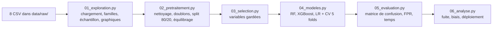

# Architecture du projet IDS multi-classes

Ce document explique le projet simplement, étape par étape. Il est mis à jour
après chaque étape avec les résultats réels, une explication du code et cinq
questions possibles du jury.

## État d'avancement

| Étape | Script | État |
|---|---|---|
| 1. Exploration | `01_exploration.py` | terminée |
| 2. Prétraitement et déséquilibre | `02_pretraitement.py` | terminée |
| 3. Sélection de variables | `03_selection.py` | terminée |
| 4. Modèles et validation croisée | `04_modeles.py` | terminée |
| 5. Évaluation sur le test | `05_evaluation.py` | à faire |
| 6. Analyse critique et déploiement | `06_analyse.py` | à faire |

Le projet est volontairement plat : `config.py` plus un script par étape.
Il n'y a pas de classes, ni de dossier `src/` avec dix modules.

---

## 1. Qu'est-ce qu'un IDS ?

Un IDS (*Intrusion Detection System*) observe une activité et signale ce qui
semble suspect. Il alerte, il ne bloque pas forcément le trafic.

- **NIDS** : analyse le trafic réseau, via un port miroir (SPAN) ou un TAP.
- **HIDS** : analyse les logs et les processus d'une machine.

Trois façons de détecter :

| Méthode | Idée | Force | Faiblesse |
|---|---|---|---|
| Signatures | règles connues (Snort, Suricata) | fiable, explicable | rate les attaques inconnues |
| Anomalies | apprentissage du comportement normal | peut surprendre | beaucoup de fausses alertes |
| Machine learning | apprentissage à partir de flux étiquetés | automatique | dépend des données |

Notre projet est un **NIDS supervisé multi-classes** : à partir d'un flux résumé
en statistiques, il prédit la famille d'attaque ou `BENIGN`.

## 2. Le dataset CIC-IDS2017

Publié par le Canadian Institute for Cybersecurity (Université du
Nouveau-Brunswick), capture du 3 au 7 juillet 2017. Page officielle :
<https://www.unb.ca/cic/datasets/ids-2017.html>.

Le lundi contient seulement du trafic normal ; les autres jours contiennent
des attaques scriptées : brute force FTP/SSH, DoS, Heartbleed, Web attacks,
infiltration, botnet, DDoS, PortScan. Chaque ligne d'un CSV est un flux extrait
par CICFlowMeter.

Colonnes utiles à connaître :

| Colonne | Signification |
|---|---|
| `Flow Duration` | durée du flux en microsecondes |
| `Total Fwd Packets`, `Total Length of Fwd Packets` | paquets et octets dans le sens initial |
| `Flow Bytes/s`, `Flow Packets/s` | débits (source de valeurs infinies) |
| `Flow IAT Mean`, `Fwd IAT Mean` | temps moyen entre deux paquets (*Inter Arrival Time*) |
| `Packet Length Mean` | taille moyenne des paquets |
| `SYN Flag Count`, `RST Flag Count`, `ACK Flag Count` | drapeaux TCP : connexion, fermeture brutale |
| `Source IP`, `Destination IP`, `Source Port`, `Destination Port`, `Timestamp` | identifiants ou horodatage, à retirer plus tard |

Les libellés bruts sont regroupés en familles pour être lisibles et assez
peuplées :

| Famille | Libellés regroupés |
|---|---|
| `BENIGN` | `BENIGN` |
| `DoS` | GoldenEye, Hulk, Slowloris, Slowhttptest |
| `DDoS` | `DDoS` |
| `PortScan` | `PortScan` |
| `BruteForce` | FTP-Patator, SSH-Patator |
| `WebAttack` | Brute Force, XSS, Sql Injection |
| `Bot`, `Infiltration`, `Heartbleed` | conservés tels quels pour l'instant |

**Échantillon** : 5 % par famille avec graine 42 ; les familles de 100 lignes
ou moins sont gardées entièrement, sinon `Heartbleed` (11 lignes) aurait
disparu. Le déséquilibre d'origine est donc conservé.

## 3. Vue d'ensemble du pipeline



## 4. Les fichiers du projet

| Fichier | Rôle |
|---|---|
| `config.py` | graine, chemins, mapping des familles, colonnes à retirer |
| `01_exploration.py` | lit les CSV, crée l'échantillon, produit les graphiques et tableaux |
| `02_pretraitement.py` ... `06_analyse.py` | une étape chacun, créés au fur et à mesure |
| `data/raw/MachineLearningCVE/` | CSV officiels (non versionnés) |
| `data/processed/` | échantillon et jeux d'entraînement/test |
| `reports/figures/`, `reports/tables/` | graphiques et tableaux CSV |
| `models/` | modèle final sauvegardé |

## 5. Choix techniques déjà faits

- **Échantillon stratifié** : le jeu complet fait 2,8 millions de lignes, trop
  lourd pour un PC ; 5 % suffisent pour comparer des modèles.
- **Libellés normalisés** : sans cela, 7 976 lignes partaient dans `AUTRE`.
- **Doublons pas encore supprimés** : on les a comptés à l'étape 1, on les
  retirera avant le split à l'étape 2 pour éviter la fuite de données.
- **Identifiants et timestamp** : la liste `RISKY_COLUMNS` est appliquée à
  l'étape 2. Dans la version des CSV fournie ici, ces colonnes ne sont déjà
  pas présentes (le fichier commence par `Destination Port`) : aucune
  suppression n'a donc été faite. Le `Destination Port` est gardé car c'est
  une information disponible en production (service visé), mais son
  importance sera surveillée aux étapes 3 et 6.
- **F1 macro et PR-AUC** (plus tard) plutôt que l'accuracy : 80 % des flux sont
  `BENIGN`, donc l'accuracy est trompeuse.

Les sections 6 (algorithmes) et 7 (métriques détaillées) seront complétées aux
étapes 4 et 5.

## 8. Comment exécuter

Depuis le dossier du projet :

```bash
pip install -r requirements.txt
python 01_exploration.py
python 02_pretraitement.py
python 03_selection.py
python 04_modeles.py
```

Le script lit les 8 CSV, écrit `data/processed/sample_stratified_5pct.csv`, puis
les graphiques dans `reports/figures/` et les tableaux dans `reports/tables/`.
Pour lire les résultats : `distribution_classes.csv` montre le déséquilibre,
`valeurs_manquantes.csv` et `valeurs_infinies.csv` les cellules à corriger,
`doublons.csv` le risque de fuite, `correlations_fortes.csv` les variables
redondantes, et `correlations.png` la heatmap.

## 9. Pièges rencontrés

- **Libellés sales** : `DoS slowloris` en minuscules, et `Web Attack` suivi d'un
  caractère de remplacement `U+FFFD` au lieu d'un espace. Corrigé par une
  normalisation des caractères et un mapping insensible à la casse.
- **Doublons** : 5 549 lignes identiques (3,92 %), à traiter avant le split.
- **Valeurs infinies** : 162 cellules dans les débits, à remplacer par NaN puis
  imputer sur le train seulement.
- **Corrélations** : 48 paires à plus de 0,95, dont des doublons de colonnes
  calculées deux fois par CICFlowMeter.
- Aucun score de modèle n'a encore été calculé : on ne peut donc pas encore
  parler de score « trop parfait ».

## 10. Glossaire (en cours)

- **Flux** : suite de paquets partageant les mêmes adresses, ports et protocole.
- **IAT** : temps entre l'arrivée de deux paquets.
- **Fuite de données** : information du test qui passe dans l'entraînement.
- **Stratifié** : tirage qui garde les proportions de chaque classe.

---

## Explication du code — étape 1

### `config.py`

Il contient uniquement des constantes : `RANDOM_STATE = 42`, les chemins
(`RAW_DIR`, `PROCESSED_DIR`, ...), la règle d'échantillonnage, le dictionnaire
`FAMILIES` et la liste `RISKY_COLUMNS`. Les dossiers de sortie sont créés au
chargement du fichier. Les autres scripts font `from config import ...`, ce qui
évite de recopier les chemins partout.

### `01_exploration.py`

Le script se lit de haut en bas.

1. `charger_csv()` repère les 8 CSV dans `data/raw/MachineLearningCVE/` (ou
   directement dans `data/raw/`), supprime l'espace en tête des colonnes et
   ajoute `source_file` et `jour`. Ces deux colonnes servent seulement plus
   tard à la validation par jour ; ce ne sont pas des features.
2. La normalisation des libellés utilise trois `str.replace` : on enlève les
   caractères bizarres, on remplace les espaces multiples par un seul, puis on
   passe par `lookup` (dictionnaire en minuscules) pour obtenir `Family`.
3. `echantillonner(df)` fait un `groupby("Family")` et tire `n` lignes par
   famille avec `sample(random_state=42)`. Les familles de moins de 100 lignes
   sont gardées en entier.
4. La distribution est construite avec `value_counts().reindex(...)` puis
   sauvegardée en CSV. Le graphique utilise une échelle log : avec 113 655
   `BENIGN` et 11 `Heartbleed`, une échelle linéaire rendrait les petites
   classes invisibles.
5. La qualité des données utilise `isna().sum()`, `np.isinf()`, `nunique()` et
   `duplicated()`. On ne supprime rien ici : on mesure d'abord.
6. Les boxplots utilisent `sns.boxplot` sur 1 000 lignes par famille (assez pour
   voir la forme des distributions). L'échelle `symlog` permet d'afficher des
   valeurs très étalées, y compris quelques négatives.
7. La heatmap utilise `df.corr()`. Pour lister les paires redondantes, on garde
   seulement le triangle supérieur avec `np.triu(..., k=1)`, sinon chaque paire
   apparaîtrait deux fois.

### Résultats réels de l'étape 1

- Brut : **2 830 743 lignes × 81 colonnes**. Échantillon : **141 581 lignes**,
  124,7 Mo, sauvegardé dans `data/processed/sample_stratified_5pct.csv`.
- Familles de l'échantillon : BENIGN 113 655 (80,28 %), DoS 12 633, PortScan
  7 946, DDoS 6 401, BruteForce 692, WebAttack 109, Bot 98, Infiltration 36,
  Heartbleed 11.
- 54 valeurs manquantes (`Flow Bytes/s`), 162 infinies (54 `Flow Bytes/s` et
  108 `Flow Packets/s`), 8 colonnes constantes, 5 549 doublons exacts (3,92 %)
  et 48 paires de variables corrélées à plus de 0,95.
- Fichiers créés : **10 figures** (`distribution_classes.png`,
  `valeurs_manquantes.png`, `correlations.png`, 6 `box_*.png`, 2
  `hist_*.png`) et **6 tableaux** (`distribution_classes.csv`,
  `valeurs_manquantes.csv`, `valeurs_infinies.csv`, `colonnes_constantes.csv`,
  `doublons.csv`, `correlations_fortes.csv`).

## Cinq questions du jury — étape 1

1. **Pourquoi 5 % et pas tout le jeu ?** Le jeu complet fait 2,8 millions de
   lignes ; 5 % = 141 581 lignes, largement suffisant pour comparer des
   modèles en CV sur un PC, et l'échantillon est fixé par la graine 42.
2. **Pourquoi garder toutes les lignes des familles rares ?** `Heartbleed` n'a
   11 exemples : à 5 %, il aurait pu disparaître complètement.
3. **Pourquoi une échelle logarithmique pour les classes ?** Le rapport est de
   10 000 à 1 entre BENIGN et Heartbleed ; en linéaire, les petites classes ne
   verraient presque rien.
4. **D'où venaient les 7 976 lignes `AUTRE` ?** De libellés mal écrits dans les
   CSV (casse et caractère `U+FFFD`). Après normalisation, elles sont classées
   dans DoS et WebAttack ; il ne reste aucun libellé inconnu.
5. **Les doublons sont-ils un problème ?** Oui : si la même ligne est en train
   et en test, le score sera gonflé. On les a comptés ici (3,92 %) et on les
   supprimera avant le split à l'étape 2.

---

## Explication du code — étape 2

`02_pretraitement.py` se lit encore de haut en bas, sans fonction compliquée.

1. **Lecture et colonnes** : on relit l'échantillon de l'étape 1. La liste
   `RISKY_COLUMNS` est appliquée, mais dans les CSV fournis ces colonnes
   n'existent pas déjà : le script affiche donc `[]`. C'est normal et c'est
   tracé dans le tableau `resume_pretraitement.csv`. Les 8 colonnes constantes
   trouvées à l'étape 1 sont retirées.
2. **Infinis** : `replace([np.inf, -np.inf], np.nan)` transforme les 162 valeurs
   infinies en `NaN`. L'imputation médiane n'est pas faite ici : elle est dans
   le pipeline, donc recalculée sur chaque fold d'entraînement.
3. **Doublons** : `drop_duplicates()` est appelé **avant** `train_test_split()`.
   C'est le point clé anti-fuite.
4. **Familles rares** : `Infiltration` (36) et `Heartbleed` (11) sont écrites
   dans `data/processed/attaques_rares.csv` puis enlevées du jeu de modèle.
   Avec environ 2 et 7 exemples dans le test, on ne peut pas tirer de
   conclusion sur leur détection.
5. **Split** : `train_test_split(..., test_size=0.2, stratify=y,
   random_state=42)`. Le jeu de test est écrit dans `test.csv` et n'est plus
   touché jusqu'à l'étape 5.
6. **Comparaison des équilibrages** : on utilise
   `imblearn.pipeline.Pipeline` avec `SimpleImputer`, `StandardScaler`, un
   sampleur, puis `LogisticRegression`. `cross_validate` avec
   `StratifiedKFold(5)` évalue chaque stratégie. Comme le sampleur fait partie
   du pipeline, il n'est ajusté que sur les 4/5 d'entraînement de chaque fold.
7. **Cibles de rééchantillonnage** : imblearn refuse un float pour le
   multi-classes, donc on donne un dictionnaire. Le sous-échantillonnage
   ramène `BENIGN` à 20 000 lignes. SMOTE vise 20 % de la taille de `BENIGN`
   pour chaque classe, avec un plafond de 10 fois la classe d'origine (pour ne
   pas créer 17 000 faux `Bot` à partir de 78 exemples).

### Résultats réels de l'étape 2

- Après déduplication : **136 032** lignes ; après retrait des 47 lignes rares :
  **135 985** lignes. Train : **108 788**, test : **27 197**.
- Classes du train : BENIGN 88 952, DoS 8 040, PortScan 6 070, DDoS 5 121,
  BruteForce 440, WebAttack 87, Bot 78.
- Comparaison en CV 5 folds (F1 macro moyen ± écart-type) :

| Stratégie | F1 macro | Accuracy | Temps |
|---|---:|---:|---:|
| `class_weight='balanced'` | 0,5616 ± 0,0019 | 0,8436 | 393 s |
| Sous-échantillonnage | 0,6395 ± 0,0106 | 0,9621 | 103 s |
| SMOTE | **0,6544 ± 0,0079** | 0,9631 | 341 s |

- L'écart entre SMOTE et le sous-échantillonnage est faible (0,015) et
  SMOTE est trois fois plus lent : le choix définitif sera fait à l'étape 4
  avec les autres modèles. Le point important est que **l'accuracy de 0,84
  du `class_weight` cache un F1 macro de 0,56** : la classe majoritaire
  domine le score.
- Fichiers créés : `data/processed/train.csv`, `test.csv`,
  `attaques_rares.csv`; `reports/tables/resume_pretraitement.csv`,
  `comparaison_equilibrage.csv`; `reports/figures/comparaison_equilibrage.png`.

## Cinq questions du jury — étape 2

1. **Pourquoi supprimer les doublons avant le split ?** Sinon une ligne
   identique peut être en train et en test ; le modèle la « connaît » déjà et
   le score est artificiellement haut. On en a retiré 5 549.
2. **Pourquoi le sampleur est-il dans le pipeline ?** Parce que dans chaque
   fold, SMOTE ne doit voir que les 4/5 d'entraînement. Si on rééchantillonnait
   avant la CV, des points synthétiques calculés à partir du fold de
   validation fuiraient dans l'entraînement.
3. **Pourquoi exclure deux familles au lieu de les garder ?** 11 et 36
   exemples donnent 2 et 7 lignes en test : le F1 par classe serait du bruit.
   Elles sont conservées dans `attaques_rares.csv` pour l'analyse critique.
4. **Pourquoi 0,84 d'accuracy avec seulement 0,56 de F1 macro ?** Parce que
   BENIGN représente 82 % du train : un modèle peut bien prédire la majorité et
   rater les petites classes. Le F1 macro donne le même poids à chaque classe.
5. **Pourquoi un dictionnaire pour `sampling_strategy` ?** En multi-classes,
   imblearn interdit les floats. On fixe donc un effectif cible par classe,
   avec un plafond pour ne pas synthétiser trop de données rares.

---

## Explication du code — étape 3

`03_selection.py` ne touche jamais à `test.csv` : tout est calculé sur
`train.csv`.

1. **Paires redondantes** : on impute le train, on calcule `corr()` puis le
   triangle supérieur avec `np.triu(k=1)`. Les 48 paires à plus de 0,95 sont
   écrites dans `correlations_train.csv`. On ne supprime pas ces colonnes ici :
   la sélection est faite dans le pipeline pour que chaque fold fasse la sienne.
2. **Filtre ANOVA** : `SelectKBest(score_func=f_classif, k=k)` classe les
   variables selon le rapport variance entre classes / variance dans les
   classes. Le classement complet est dans `top15_features.csv`.
3. **Embarquée** : `SelectFromModel(RandomForestClassifier(...), max_features=k)`
   garde les variables que la forêt juge les plus utiles. La forêt sert aussi
   de modèle final pour noter chaque candidat, avec `class_weight` pour ne pas
   écraser les petites classes.
4. **Courbe** : pour k = 5, 10, 15, 25, 40 et 70, on fait une CV à 3 folds et
   on trace le F1 macro moyen avec son écart-type. Le pipeline contient
   l'imputation, `VarianceThreshold`, la sélection puis la forêt : tout est
   recalculé sur les 2/3 d'entraînement de chaque fold.
5. **Contrôle du port** : `Destination Port` arrive premier des importances RF.
   On refait la sélection à 15 variables sans cette colonne. Le F1 passe de
   0,8153 à **0,8398** : le port était donc un raccourci lié au service visé,
   pas une information robuste. Il est exclu de la sélection finale.
6. **Choix final** : on garde **15 variables choisies par la forêt**. Avec les
   70 variables le F1 est de 0,8689, donc on perd 0,029 de F1 mais on divise le
   nombre de variables par 4,7 et on supprime un biais de service.

### Résultats réels de l'étape 3

| k | ANOVA F1 | Random Forest F1 |
|---:|---:|---:|
| 5 | 0,5290 | 0,7856 |
| 10 | 0,6113 | 0,7915 |
| 15 | 0,6334 | 0,8153 |
| 25 | 0,6313 | 0,8124 |
| 40 | 0,8062 | 0,8079 |
| 70 | 0,8689 | 0,8689 |

- La méthode embarquée est bien meilleure que l'ANOVA pour peu de variables :
  0,8153 contre 0,6334 avec 15 variables. À 70 variables, les deux méthodes
  donnent le même score puisqu'elles gardent tout.
- Contrôle `Destination Port` : avec 0,8153 ± 0,0222 ; sans 0,8398 ± 0,0389.

Les 15 variables retenues et leur rôle :

| Variable | Signification réseau |
|---|---|
| `Init_Win_bytes_backward` | fenêtre TCP initiale dans le sens réponse |
| `Subflow Fwd Bytes` | octets dans un sous-flux |
| `Bwd Packet Length Mean` | taille moyenne des paquets reçus |
| `Average Packet Size` | taille moyenne globale des paquets |
| `Bwd Packet Length Min` | plus petit paquet reçu |
| `Packet Length Variance` | variance des tailles de paquets |
| `Packet Length Mean` | taille moyenne de tous les paquets |
| `Packet Length Std` | variabilité des tailles de paquets |
| `min_seg_size_forward` | plus petit segment TCP envoyé |
| `Init_Win_bytes_forward` | fenêtre TCP initiale dans le sens initial |
| `Fwd Packet Length Mean` | taille moyenne des paquets envoyés |
| `Total Length of Fwd Packets` | octets envoyés dans le sens initial |
| `Fwd IAT Max` | plus long intervalle entre paquets envoyés |
| `Subflow Bwd Bytes` | octets dans le sous-flux inverse |
| `Flow Bytes/s` | débit du flux en octets par seconde |

Presque toutes décrivent la **taille, le rythme et la fenêtre TCP** des flux :
c'est cohérent avec des attaques qui changent le volume (DoS, DDoS) ou le
comportement de connexion (scan, brute force). Cela dit, aucune variable ne
décrit le contenu chiffré : les limites du dataset restent entières.

Fichiers créés : `data/processed/selected_features.txt`,
`reports/tables/correlations_train.csv`, `top15_features.csv`,
`courbe_selection.csv`, `controle_port.csv`, `selection_finale.csv`, et
`reports/figures/courbe_selection.png`.

## Cinq questions du jury — étape 3

1. **Pourquoi la sélection est-elle dans le pipeline ?** Pour que l'ANOVA ou
   la forêt ne voient que les données d'entraînement de chaque fold. Sinon les
   variables choisies dépendraient du fold de validation.
2. **Pourquoi la forêt bat-elle l'ANOVA avec peu de variables ?** L'ANOVA ne
   regarde que la corrélation linéaire avec la cible ; la forêt capte des
   combinaisons non linéaires de tailles et d'intervalles de paquets.
3. **Pourquoi ne pas garder les 70 variables puisque c'est le meilleur F1 ?**
   0,8689 contre 0,8398, soit 0,029 d'écart pour 4,7 fois plus de variables à
   traiter à chaque inférence. Le compromis est en faveur des 15 variables.
4. **Pourquoi retirer `Destination Port` alors qu'il est premier ?** C'est une
   information sur le service visé (port 22, 80...). Le contrôle montre qu'on
   gagne 0,025 de F1 sans lui : le modèle se concentre sur le comportement du
   trafic plutôt que sur une correspondance de ports.
5. **Que prouve la courbe score / nombre de variables ?** Qu'au-delà de 15
   variables le gain est faible et instable (0,8153 à 15, 0,8124 à 25, 0,8079
   à 40), puis le score saute à 70 parce qu'on ne sélectionne plus rien.

---

## Explication du code — étape 4

`04_modeles.py` utilise uniquement `train.csv` et les 15 variables choisies à
l'étape 3.

1. **Labels numériques** : `LabelEncoder` transforme les sept familles en
   entiers, car XGBoost refuse les chaînes de caractères. L'encodeur est
   sauvegardé dans `models/label_encoder.joblib` pour l'étape 5.
2. **Cinq modèles** : Random Forest, XGBoost, régression logistique, arbre de
   décision et kNN. Tous passent par le même pipeline : imputation → mise à
   l'échelle → SMOTE → modèle. Le SMOTE est recalculé dans chaque fold, donc
   il ne voit jamais le fold de validation.
3. **Métriques** : `cross_validate` avec un `StratifiedKFold(5)`. On relève le
   F1 macro, le F1 pondéré, le rappel macro, la précision macro et le PR-AUC
   macro. Ce dernier est calculé par une petite fonction locale : on binarise
   les labels, on trace la courbe précision-rappel de chaque classe avec
   `precision_recall_curve`, on prend l'aire avec `auc`, puis la moyenne.
4. **Significativité** : on compare `moyenne - écart-type` du premier à
   `moyenne + écart-type` du deuxième. Si les intervalles se chevauchent, on ne
   déclare pas de différence nette.
5. **Réglage** : `RandomizedSearchCV` à 4 essais et CV à 3 folds sur les deux
   meilleurs modèles. Les modèles réglés sont ensuite **réévalués avec la même
   CV à 5 folds** que la comparaison initiale, pour ne pas mélanger des scores
   obtenus sur des découpages différents.
6. **Sauvegarde** : le meilleur modèle réglé est entraîné sur tout le train.
   On retire le SMOTE de la chaîne avant de sauvegarder : l'échantillonnage ne
   doit jamais agir au moment de prédire. Le modèle sert dans l'étape 5.

### Résultats réels de l'étape 4

| Modèle | F1 macro | F1 pondéré | Rappel macro | Précision macro | PR-AUC macro | Temps |
|---|---:|---:|---:|---:|---:|---:|
| Random Forest | 0,8693 ± 0,0088 | 0,9960 | 0,9503 | 0,8399 | 0,8678 | 65 s |
| **XGBoost** | **0,8737 ± 0,0165** | **0,9966** | **0,9758** | 0,8368 | **0,8814** | 146 s |
| Régression logistique | 0,4066 ± 0,0060 | 0,8602 | 0,4318 | 0,4073 | 0,5317 | 73 s |
| Arbre de décision | 0,8454 ± 0,0128 | 0,9925 | 0,9589 | 0,8057 | 0,8501 | 8 s |
| kNN | 0,8204 ± 0,0068 | 0,9926 | 0,9249 | 0,7788 | 0,8392 | 40 s |

- XGBoost est premier au F1 macro et au PR-AUC macro. Son rappel macro est
  aussi le meilleur : 0,9758.
- Les intervalles `0,8737 ± 0,0165` et `0,8693 ± 0,0088` se chevauchent :
  l'écart avec Random Forest n'est **pas nettement significatif**.
- Le F1 pondéré avoisine 0,996 pour les bons modèles. Ce chiffre est trompeur :
  BENIGN représente 82 % du train. Le F1 macro reste notre référence.
- La régression logistique rate plusieurs petites classes : sklearn émet un
  avertissement « precision is ill-defined ». C'est cohérent avec son F1 macro
  de 0,4066 malgré 0,86 de F1 pondéré.

Réglage (CV à 3 folds) puis réévaluation (CV à 5 folds) :

| Modèle | Meilleurs paramètres | F1 3 folds | F1 5 folds | PR-AUC 5 folds |
|---|---|---:|---:|---:|
| XGBoost | 250 arbres, profondeur 4, lr 0,05 | 0,8651 | **0,8714** ± 0,0105 | 0,8798 |
| Random Forest | 200 arbres, profondeur 15, feuille 1 | 0,8654 | 0,8693 ± 0,0088 | 0,8678 |

Le réglage n'a pas augmenté le score de XGBoost (0,8714 contre 0,8737 avant),
mais l'écart reste dans l'écart-type et le modèle est plus simple (profondeur 4
au lieu de 6). C'est cette version réglée qui est sauvegardée dans
`models/final_model.joblib`, avec `models/label_encoder.joblib`.

Fichiers créés : `reports/tables/comparaison_modeles.csv`,
`meilleurs_parametres.csv`, `comparaison_apres_reglage.csv`,
`meilleur_modele.csv`, `reports/figures/comparaison_modeles.png`,
`models/final_model.joblib` et `models/label_encoder.joblib`.

## Cinq questions du jury — étape 4

1. **Pourquoi 5 folds et pas un simple split ?** Un seul split dépend trop de la
   chance du découpage. Avec 5 folds, chaque ligne sert une fois à valider et
   quatre fois à entraîner ; on obtient une moyenne et un écart-type.
2. **Pourquoi le SMOTE reste-t-il dans le pipeline ?** Pour qu'il ne voie que
   les données d'entraînement du fold en cours. Sans cela, des points
   synthétiques fuiraient dans la validation et gonfleraient le score.
3. **Pourquoi XGBoost plutôt que Random Forest ?** Son F1 macro (0,8737 contre
   0,8693) et son PR-AUC (0,8814 contre 0,8678) sont un peu meilleurs, et son
   rappel macro est plus élevé. On reste prudent car les écarts-types se
   chevauchent.
4. **Pourquoi ne pas conclure que XGBoost est nettement meilleur ?** Parce que
   0,8737 ± 0,0165 recoupe 0,8693 ± 0,0088. La différence de 0,0044 est plus
   petite que la variation entre folds.
5. **Pourquoi le F1 pondéré de 0,996 ne prouve rien ?** Parce que 82 % des
   lignes sont `BENIGN` : un modèle peut réussir sur la majorité et échouer sur
   les attaques rares. Le F1 macro donne un poids égal à chaque famille.

